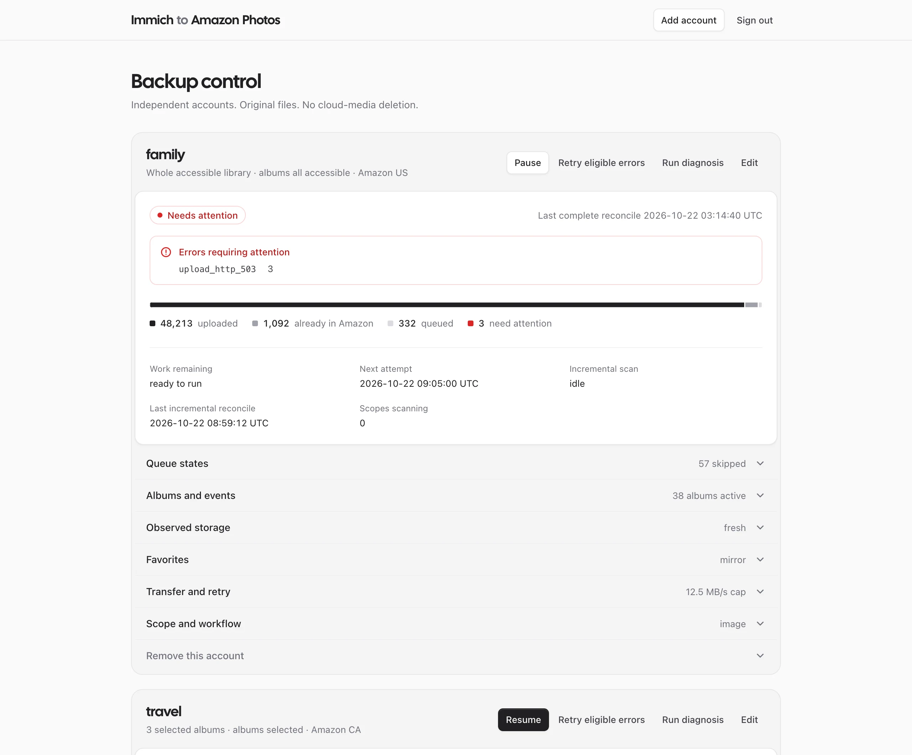

# immich-amazon-sync

One-way backup from [Immich](https://github.com/immich-app/immich) to Amazon Photos — original bytes, zero duplicates, single container.

<picture>
  <source media="(prefers-color-scheme: dark)" srcset="docs/images/dashboard-dark.webp">
  
</picture>

<sub>Screenshot uses sample data.</sub>

## Highlights

- **Original preservation** — exact byte streams, no transcoding or EXIF modification
- **Deduplication** — matches size + MD5 against remote before uploading
- **Album sync** — whole library, selected albums, or remote album mirroring
- **Deletion safety** — remote deletes disabled by default; opt-in requires explicit confirmation
- **Direct disk access** — optional read-only host mount to skip network downloads
- **Transfer windows · Live Photos · Favorites sync** — [full capabilities →](docs/explanation/architecture.md)

## Quick start

### Prerequisites

Docker Engine with Compose v2+ · Immich instance & API key · Amazon Photos session cookie ([how to obtain](docs/how-to/credentials.md))

### 1. Clone & configure

```bash
git clone https://github.com/thedavidweng/immich-amazon-sync.git
cd immich-amazon-sync
cp docs/reference/config.example.json config.json
mkdir -m 700 secrets
```

### 2. Add credentials

```bash
echo "YOUR_IMMICH_API_KEY"        > secrets/immich-api-key
echo "YOUR_AMAZON_COOKIE_HEADER"  > secrets/amazon-cookie
chmod 600 secrets/*
```

On Linux, verify files are readable by container UID 10001 (or `chmod 644`).

### 3. Edit config.json

```json
{
  "data_dir": "/data",
  "listen": "0.0.0.0:8080",
  "accounts": [
    {
      "id": "primary",
      "immich_url": "http://immich-server:2283",
      "immich_api_key_file": "/run/secrets/immich_api_key",
      "amazon_region": "us",
      "amazon_cookie_file": "/run/secrets/amazon_cookie",
      "library": true
    }
  ]
}
```

### 4. Start

```bash
docker compose build
docker compose run --rm sync --config /etc/immich-amazon-sync/config.json doctor --json  # verify connectivity
docker compose up -d
```

## Documentation

| Guide | |
| --- | --- |
| [First backup tutorial](docs/tutorials/first-backup.md) | Guided walkthrough for initial setup |
| [Credentials](docs/how-to/credentials.md) | Amazon cookie & Immich API key management |
| [Configuration reference](docs/reference/configuration.md) | Full JSON schema ([example](docs/reference/config.example.json)) |
| [CLI reference](docs/reference/cli.md) | Commands, flags, exit codes |
| [Architecture](docs/explanation/architecture.md) | Pipeline, deduplication, guarantees |
| [Safety model](docs/explanation/safety.md) | Idempotency & deletion guards |

<details>
<summary>More guides</summary>

- [Local management](docs/how-to/local-management.md) — optional web dashboard
- [Direct originals](docs/how-to/direct-originals.md) — mount local Immich storage
- [Managed albums](docs/how-to/managed-albums.md) — album sync modes & membership guards
- [Operations](docs/how-to/operations.md) — backup, restore, migrations, transfer windows
- [Event hints](docs/how-to/event-hints.md) — webhooks & [managed workflows](docs/how-to/managed-workflows.md)
- [Troubleshooting](docs/how-to/troubleshooting.md) — uncertain writes, auth failures
- [Status & metrics](docs/reference/status.md) — health endpoints & Prometheus
- [Compatibility](docs/reference/compatibility.md) — upstream pins, quotas, [feature parity](docs/reference/parity.md)
- [ADRs](docs/adr/) — architecture decision records

</details>

## Related projects

| Project | Description |
| --- | --- |
| [`amazon-photos`](https://github.com/thedavidweng/amazon-photos) | Go SDK & `aphotos` CLI — shared foundation |
| [`rainforest`](https://github.com/thedavidweng/rainforest) | Desktop app for upload, folder backup & recovery |

<details>
<summary>Acknowledgements</summary>

- [immich-gphotos](https://github.com/ImAleeexx/immich-gphotos) — workflow patterns and reconciler model
- [vanessa/immich-amazon-sync](https://github.com/vanessa/immich-amazon-sync) — early integration scenarios

</details>

## Disclaimer

Amazon Photos has no official public API. This service uses an unofficial SDK; sessions expire and upstream behavior can change without notice. Always maintain an independent primary backup of your media.

## License

[AGPL-3.0-only](LICENSE) · [Third-party notices](THIRD_PARTY_NOTICES.md)
